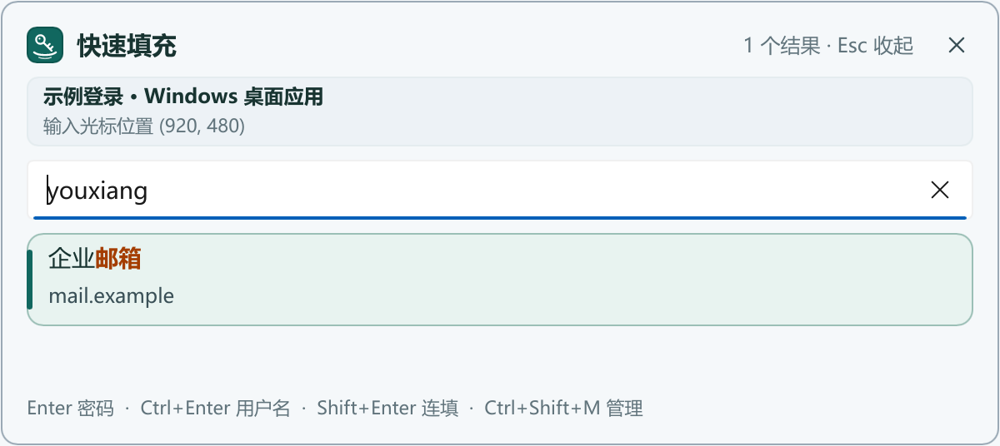
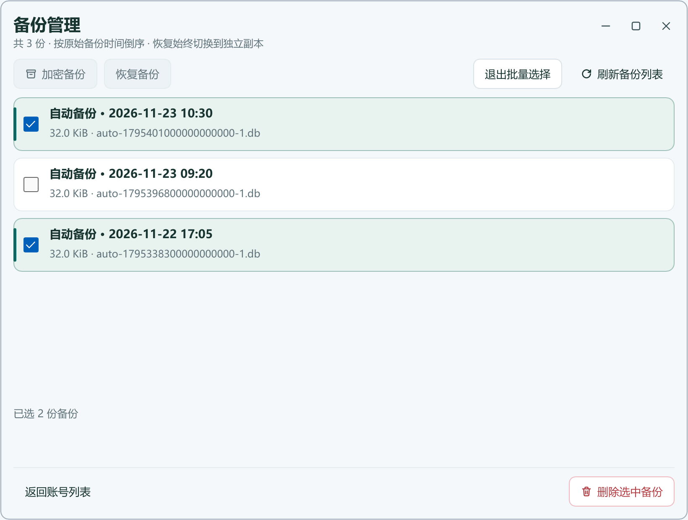

# Keyisle

**English** · [简体中文](README.zh-CN.md)

A lightweight, local password manager for Windows.

Keyisle (密屿) keeps your credentials in an encrypted local vault and brings them to the input you choose. Organize accounts with categories and tags, find them with fuzzy search, and fill them from a keyboard-driven popup. Built with Rust, Slint, and SQLCipher.

**[Download the latest release](https://github.com/dfx1822375/Keyisle/releases/latest)** · [Quick start](#quick-start) · [Keyboard shortcuts](#keyboard-shortcuts)


Screenshots use synthetic accounts. The current application interface and the linked technical guides are in Simplified Chinese.

## Install

**[Open the latest downloads](https://github.com/dfx1822375/Keyisle/releases/latest)** and choose an asset:

| Download | Choose this for |
| --- | --- |
| [Windows x64 installer](https://github.com/dfx1822375/Keyisle/releases/latest) — `Keyisle-<version>-Setup-x64.exe` | Recommended. Installation wizard, Start menu entry, optional desktop shortcut, and uninstaller. |
| [Portable ZIP](https://github.com/dfx1822375/Keyisle/releases/latest) — `Keyisle-<version>-Windows-x64-portable.zip` | Extract the archive and run `Keyisle.exe`. |
| [SHA256SUMS](https://github.com/dfx1822375/Keyisle/releases/latest) | Compare download hashes with PowerShell's `Get-FileHash -Algorithm SHA256`. |

These links follow the latest published release. No Rust toolchain, database installation, or extra runtime is needed to use the Windows x64 app.

The installer runs for the current user, without administrator privileges. Program files default to `%LOCALAPPDATA%\Programs\Keyisle`; vaults and preferences use `%LOCALAPPDATA%\PasswordHelper`. The portable app uses the same data location.

Seamless in-place upgrades are supported without manually exiting from the tray: whether upgrading from **About Keyisle** inside the app or running a new `Setup.exe` directly, the running instance is notified to lock the vault and exit gracefully (prompting first if unsaved account edits exist) while keeping all accounts, backups, and preferences intact. Uninstalling also preserves your data. See the [installation and uninstall guide](docs/installation.md).

The current installer is unsigned. Windows may show an unknown-publisher or download-reputation prompt.

## Quick start

1. Create a local vault with a master password of at least 10 characters. A forgotten master password cannot be recovered.
2. Add an account with a name, username, and password. Categories, tags, a URL, and notes help you organize it.
3. Click the destination input in your browser or desktop app, then press `Ctrl+Alt+P`.
4. Search, choose an account with `↑` / `↓`, and press a fill shortcut below. Keyisle never presses Enter to submit the login.

## Find and fill from the keyboard

Search names, usernames, categories, tags, and URLs using Chinese text, full pinyin, pinyin initials, multiple terms, or typo-tolerant matching. Matches are highlighted; passwords and notes are excluded from search.

With an empty query, the popup favors accounts recently used successfully in the target application. With a query, relevance comes first. Failed or canceled fills do not change recent ordering.



The popup shows the destination application, window or page title, and position source. Selecting an entry does not fill it until you confirm. `Esc` dismisses the popup even when another ordinary application has focus; `Ctrl+Shift+M` opens the main window.

Application history is a sorting aid. Chrome websites currently share the browser's application history; this is not website identity verification.

## Manage accounts and sensitive entries

Store categories, tags, URLs, and notes alongside each account, with a built-in CSPRNG password generator in the editor so new passwords never need to pass through an external clipboard. Use the context menu, double-click, or `F2` to edit. `Alt+Enter` opens read-only details with the password masked by default and an optional protected copy action (excluded from Windows Clipboard History and auto-cleared after 15 seconds or on lock); viewing a sensitive entry does not authorize a later edit.

Mark an entry as sensitive to require verification before viewing, editing, deleting, or filling it. Windows account password verification is the default; `Tab` switches to PIN / Windows Hello or the vault master password. Each approval is limited to the current action. Windows account passwords are collected by the system credentials dialog and are not stored in the vault.


## Appearance, locking, and backups

Choose system, light, or dark appearance with teal, blue, violet, or graphite accents, plus optional window screen-capture protection and automatic background update checks. Record a shortcut by pressing the keys you want, and save appearance, capture protection, shortcut, lock, startup, and update preferences together. The main window supports dragging and resizing and remembers its layout across restarts.

The default lock timeout is 5 minutes of computer inactivity. Both the timeout and idle basis are configurable. Windows session lock, sleep, and disconnection lock the vault and cancel pending consent or filling. Manual launch opens the main window; automatic startup can remain in the tray.




Keyisle creates encrypted backups before editing existing accounts. Deleting accounts, individually or in a batch, creates no new backup. Choose Batch select in the account list to select and delete multiple accounts. A batch containing a sensitive entry requires one verification.

Set a default backup folder in Settings. Export and restore dialogs open there, and you can browse elsewhere for any individual operation. Backup management lists software-managed backups and database files in the selected folder. You can select multiple backups and confirm deletion with the current vault master password. Restore creates a separate working copy. Changing the master password updates software-managed backups. Manual exports keep their previous password.

Reset requires the current vault master password and confirmation. It removes software-managed vaults, backups, preferences, and startup registration. External exports and unknown files are retained. File deletion is not secure erasure. See [storage and backup behavior](docs/storage.md).

## Keyboard shortcuts

| Action | Shortcut |
| --- | --- |
| Open quick-fill popup | `Ctrl+Alt+P`, configurable in Settings |
| Choose an entry | `↑` / `↓` |
| Fill password only | `Enter` |
| Fill username only | `Ctrl+Enter` |
| Fill username → Tab → password | `Shift+Enter`, starting from the username input |
| Open main window from popup | `Ctrl+Shift+M` |
| Dismiss popup | `Esc`, including while another ordinary app has focus |
| View account details in main window | `Alt+Enter` |
| Edit account | Double-click or `F2` |
| Open account context menu | Right-click or `Shift+F10` |
| Switch verification method | `Tab` / `Shift+Tab` |

## Security and updates

- The vault is encrypted locally with SQLCipher. Filling uses Unicode keyboard simulation and does not pass credentials through the clipboard.
- Elevated apps, protected inputs, and remote sessions may reject simulated input. Browser fields can share window handles; Keyisle cannot prove a website or field has remained unchanged. Reopen the popup after changing the destination page or input.
- Global Escape handling applies to the ordinary interactive desktop. Windows secure desktop remains isolated; Keyisle does not record other keystrokes.
- Keyisle has not undergone an independent security audit. Automated tests cannot replace an audit or protect a compromised operating system.
- Built-in update checking and seamless in-place upgrades are enabled for both installer and portable deployments: Keyisle verifies an ECDSA P-256 signed `update.json` manifest against its embedded release public key, enforces version monotonicity and SHA-256 integrity, locks the vault, and upgrades in place. Manual downloads remain available on the [latest release page](https://github.com/dfx1822375/Keyisle/releases/latest).

The [validation record](docs/validation.md) separates automated checks from untested manual scenarios, including real aTrust use, successful PIN verification, multiple monitors, and DPI changes. The [acceptance checklist](docs/acceptance.md) and [release process](docs/release.md) provide further details.

## Build from source

For development in WSL2, install Rust, LLVM including `llvm-rc`, cargo-xwin, and Python 3. Building the installer also requires NSIS. Build caches default to `E:\CodexBuild\windows-password-manager`; override with `PASSWORD_MANAGER_BUILD_ROOT`.

```bash
bash scripts/test-core.sh
bash scripts/build-windows.sh
python3 scripts/generate-notices.py
python3 scripts/build-installer.py
```

The icon source is `assets/keyisle.svg`; `scripts/generate-icon.ps1` generates the Windows icon sizes and installer sidebar. Release packaging uses an explicit file whitelist and keeps the latest three local release versions and their diagnostics.

## License

Keyisle is licensed under [MIT](LICENSE). Dependency notices are included in [THIRD-PARTY-NOTICES.txt](THIRD-PARTY-NOTICES.txt). The interface is powered by [Slint](https://slint.dev/), with attribution in the application's About page.
