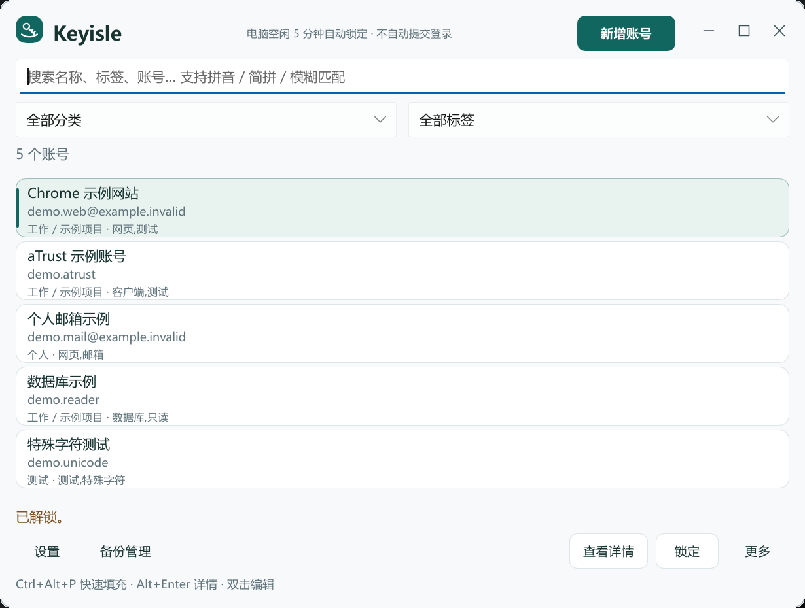

# Keyisle

密屿，一款轻量的 Windows 本地密码管理器。使用 Rust、Slint 与 SQLCipher，支持分类标签、拼音模糊搜索，以及浏览器和桌面软件中的快捷填充。

当前为 **1.0.0 发布候选版**。源代码采用 MIT 许可证；Windows x64 用户无需安装 Rust、数据库或额外运行时。



## 安装与升级

推荐使用 `Keyisle-1.0.0-Setup-x64.exe`：这是带安装向导的安装包，支持选择安装位置、开始菜单入口、可选桌面快捷方式，以及 Windows 应用列表中的卸载入口。默认安装到当前用户的 `%LOCALAPPDATA%\Programs\Keyisle`，无需管理员权限。

升级时先从托盘退出旧版，再运行新安装包。已有账号、主密码、备份与偏好会保留。卸载也保留这些数据；如需清空，先在应用设置中使用“一键还原”。便携包中的 `Keyisle.exe` 可直接运行。

旧版默认数据目录继续使用 `%LOCALAPPDATA%\PasswordHelper`，从旧版升级不需要手动搬动密码库。详情见 [安装与卸载](docs/installation.md)。

## 开始使用

1. 设置至少 10 个字符的主密码并确认，创建空密码库；忘记主密码无法找回。
2. 新增账号，填写名称、用户名、密码、分类和标签。网址与备注可选。
3. 点击目标软件的输入框，按 `Ctrl+Alt+P` 呼出悬浮框，搜索并选择账号。
4. 按下相应组合键填入。程序不会自动按 Enter 提交登录。

| 操作 | 按键 |
| --- | --- |
| 呼出悬浮框 | Ctrl+Alt+P，可在设置中录制其他组合 |
| 选择账号 | ↑ / ↓ |
| 仅填密码 | Enter |
| 仅填用户名 | Ctrl+Enter |
| 用户名 → Tab → 密码 | Shift+Enter，从用户名框开始 |
| 打开主界面 | Ctrl+Shift+M |
| 关闭悬浮框 | Esc，即使焦点已在其他普通应用窗口 |
| 主界面查看详情 | Alt+Enter |
| 主界面编辑 | 双击账号或 F2 |
| 账号菜单 | 右键或 Shift+F10 |

悬浮框顶部显示目标应用、窗口/页面标题和位置来源。选中账号不会自动填入，仍需明确触发填充。

## 搜索与账号查看

支持名称、用户名、分类、标签的中文、全拼、拼音首字母、错拼与多词匹配，不搜索密码或备注。搜索命中会高亮。

悬浮框在空查询下优先显示此应用最近成功使用的账号；输入关键词后，匹配程度优先。失败或取消不更新最近使用。主界面继续按整体最近使用排序。应用识别用于排序，不作为授权依据；Chrome 的不同网站暂按同一个浏览器应用处理。

通过“查看详情”或账号菜单查看只读的用户名、分类、标签、网址、备注和默认隐藏的密码；HTTP/HTTPS 网址可交给默认浏览器打开。编辑仍使用独立入口。

## 敏感项与锁定

敏感项在查看、编辑、删除或填充前要求复验。默认 Windows 账户密码，可切换 PIN / Windows Hello 或密码库主密码；授权仅用于当次操作，不能跨操作复用。Windows 账户密码由系统凭据窗口收集，不写入密码库。

默认电脑空闲 5 分钟锁库，设置中可调整时间和计时依据。Windows 锁屏、休眠及会话断开会立即锁库，取消尚未完成的授权和填充。重启后需要重新解锁。

## 界面与设置

提供跟随系统、浅色、深色外观，以及青绿、经典蓝、柔和紫和石墨灰配色。外观、快捷键、锁定规则和启动偏好通过同一个“保存设置”提交。

主窗口支持拖动、四边四角缩放，跨重启记住大小、位置和最大化状态。手动运行始终显示主界面；仅开机启动可按偏好留在托盘。

## 备份与还原

修改或删除账号前创建加密备份，也可手动导出、管理本地备份或从备份恢复独立工作副本。修改主密码会同步更新软件管理的本地备份，外部手动副本保留原密码。

“一键还原”需要当前库主密码和明确确认，会删除软件管理的密码库、恢复副本、自动及升级前备份，清空偏好和开机启动登记，随后重新建库。外部手动导出与未知文件保留。验证失败不改文件；清除开始后无法撤销，文件占用等错误可继续或重启恢复。普通文件删除不等于安全擦除。

详见 [存储说明](docs/storage.md)。

## 更新与公开发布

准备通过 GitHub Releases 提供安装包、便携包和校验清单。本候选版尚未连接发布仓库，自动更新未启用。

计划采用定期检测与提示、用户确认后下载安装包、安装前锁库并退出、覆盖升级保留数据的方式。仓库创建后需固定更新来源、完成校验和实际升级测试，再启用该通道；不会把任意下载链接作为可信更新执行。见 [发布流程](docs/release.md)。

## 当前边界

- 填充采用 Unicode 模拟按键，不经过剪贴板；高权限软件、安全输入框和远程会话可能拒绝模拟输入。
- 浏览器字段可能共用窗口句柄，程序不能证明网页域名和输入字段从未变化。切换页面或目标字段后请重新呼出。
- 全局 Esc 作用于普通交互桌面；Windows 安全桌面受系统隔离。程序不记录其他按键内容。
- 本软件尚未经过独立第三方安全审计。自动化回归不等同于安全审计，也不能防御已被控制的操作系统。

[验证记录](docs/validation.md) 区分自动通过项和人工未测项；[验收清单](docs/acceptance.md) 包含实际 aTrust、PIN、多显示器与 DPI 等检查。

## 开发与构建

主要开发环境为 WSL2，需要 Rust、LLVM（含 `llvm-rc`）、cargo-xwin 和 Python 3；安装器使用 NSIS。默认构建缓存位于 `E:\CodexBuild\windows-password-manager`，可通过 `PASSWORD_MANAGER_BUILD_ROOT` 调整。

```bash
bash scripts/test-core.sh
bash scripts/build-windows.sh
python3 scripts/generate-notices.py
python3 scripts/build-installer.py
```

图标源文件为 `assets/keyisle.svg`；`scripts/generate-icon.ps1` 生成 Windows 多尺寸 ICO 和安装向导侧栏。打包工具只收录白名单文件，并保留最近 3 个发布版本及对应诊断。

Keyisle 自身采用 [MIT](LICENSE) 许可证；第三方依赖按各自许可证使用，通知见 `THIRD-PARTY-NOTICES.txt`。界面由 [Slint](https://slint.dev/) 驱动，应用“关于”页包含 Slint 署名。
