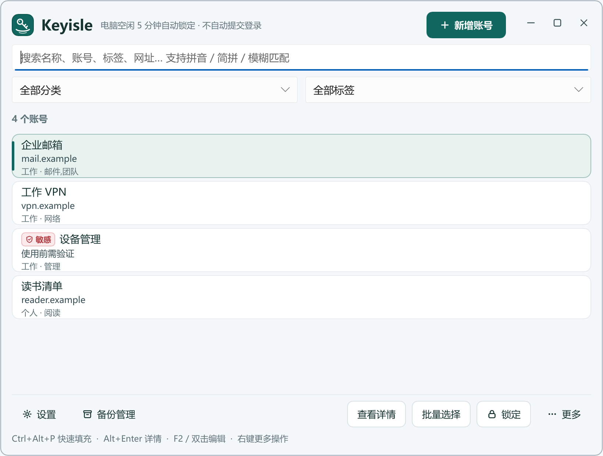
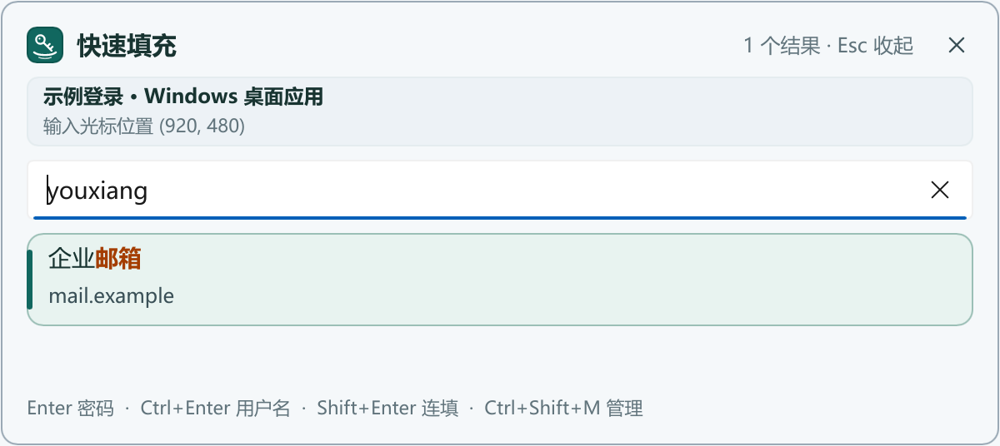
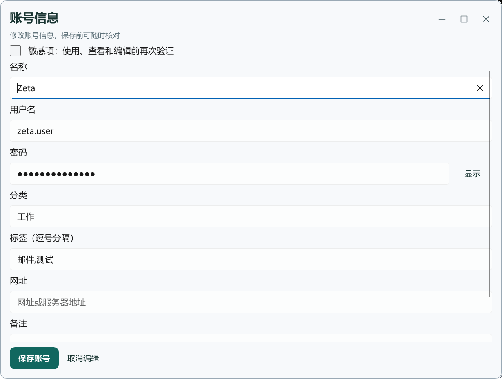
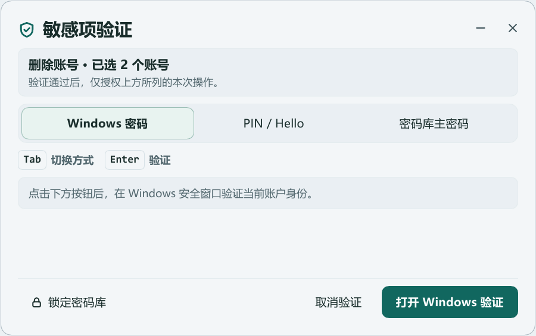
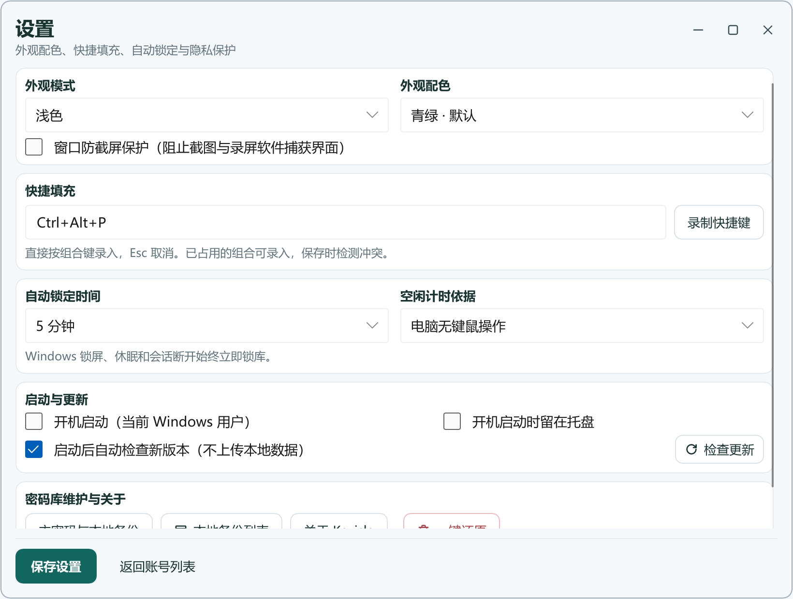
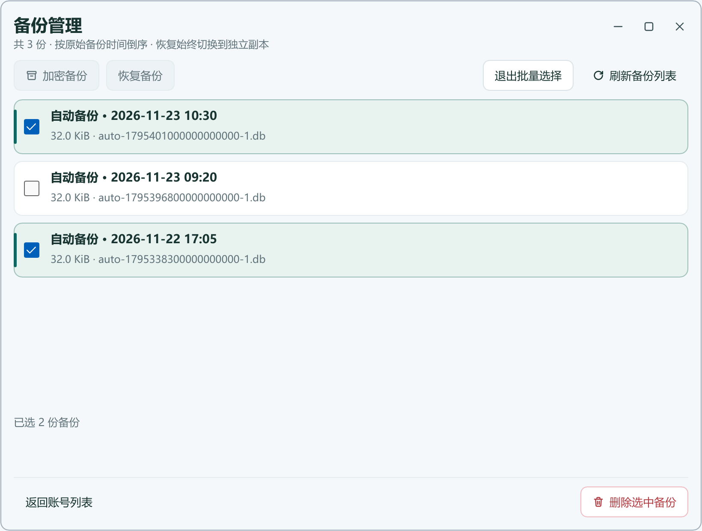

# Keyisle

[English](README.md) · **简体中文**

一款轻量的 Windows 本地密码管理器，中文名为“密屿”。

Keyisle 使用 Rust、Slint 与 SQLCipher，将账号保存在本地加密密码库中。通过分类和标签整理账号，用模糊搜索快速查找，再从键盘操作的悬浮框填入目标输入框。

**[下载最新版本](https://github.com/dfx1822375/Keyisle/releases/latest)** · [快速上手](#快速上手) · [键盘快捷键](#键盘快捷键)



本文截图均使用合成测试账号。当前应用界面和技术文档为简体中文。

## 安装

**[打开最新版下载页](https://github.com/dfx1822375/Keyisle/releases/latest)**，在附件中选择：

| 下载内容 | 适用方式 |
| --- | --- |
| [Windows x64 安装包](https://github.com/dfx1822375/Keyisle/releases/latest) — `Keyisle-<版本>-Setup-x64.exe` | 推荐。提供安装向导、开始菜单入口、可选桌面快捷方式和卸载入口。 |
| [便携 ZIP](https://github.com/dfx1822375/Keyisle/releases/latest) — `Keyisle-<版本>-Windows-x64-portable.zip` | 解压后运行 `Keyisle.exe`。 |
| [SHA256SUMS](https://github.com/dfx1822375/Keyisle/releases/latest) | 使用 PowerShell 的 `Get-FileHash -Algorithm SHA256` 比对下载文件。 |

以上链接始终跳转到最新公开版本。Windows x64 用户无需安装 Rust、数据库或额外运行时。

安装器仅面向当前用户，无需管理员权限。默认程序目录为 `%LOCALAPPDATA%\Programs\Keyisle`，密码库与偏好目录为 `%LOCALAPPDATA%\PasswordHelper`。便携版也使用同一数据目录。

支持免手动退出覆盖升级：无论在应用“关于 Keyisle”中点击一键更新，还是直接双击运行新版安装包，都会自动通知正在运行的旧实例锁库并平滑退出（若存在未保存草稿会先提示处理），保留全部账号、备份与偏好；卸载同样保留数据。详情见[安装与卸载说明](docs/installation.md)。

当前安装包尚未签名，Windows 可能显示“未知发布者”或下载信誉提示。

## 快速上手

1. 设置至少 10 个字符的主密码，创建本地密码库。忘记主密码后无法找回。
2. 新增账号，填写名称、用户名和密码。可通过分类、标签、网址和备注补充信息。
3. 点击浏览器或桌面软件的目标输入框，按 `Ctrl+Alt+P` 呼出悬浮框。
4. 搜索账号，通过 `↑` / `↓` 选择，再按对应快捷键填入。程序不会自动按 Enter 提交登录。

## 搜索与快捷填充

支持按名称、用户名、分类、标签和网址搜索。可以输入中文、全拼、拼音首字母或多个关键词，也支持错拼与子序列模糊匹配。命中内容会高亮；密码和备注不参与搜索。

空查询时，悬浮框优先显示在目标应用中最近成功使用的账号。输入关键词后，匹配程度优先。填充失败或取消不会改变最近使用顺序。



悬浮框顶部显示目标应用、窗口或页面标题，以及位置来源。选中账号后仍需明确触发填充。即使焦点已切换到其他普通应用，`Esc` 也能收起悬浮框；`Ctrl+Shift+M` 可进入主界面。

应用使用记录仅用于排序。Chrome 中的不同网站目前共用浏览器应用记录，不能据此验证网站身份。

## 账号管理与敏感项

每个账号可保存分类、标签、网址和备注；编辑页内置系统级密码学安全随机密码生成器，无需借助外部剪贴板生成新密码。通过右键菜单、双击或 `F2` 编辑账号；按 `Alt+Enter` 打开只读详情，密码默认隐藏，并提供带防历史记录标记、15 秒或锁库自动清除的临时复制兜底（供高权限窗口等拒绝模拟输入的场景使用）。敏感项的查看授权不能用于后续编辑。

将账号标记为敏感项后，查看、编辑、删除和填充都需要单独验证。默认使用 Windows 账户密码，按 `Tab` 可切换 PIN / Windows Hello 或密码库主密码。每次授权仅用于当前操作。Windows 账户密码由系统凭据窗口收集，不写入密码库。

| 账号编辑 | 敏感项验证 |
| --- | --- |
|  |  |

## 外观、锁定与备份

支持跟随系统、浅色和深色外观，以及青绿、经典蓝、柔和紫和石墨灰配色，并可按需开启窗口防截屏与录屏保护、配置启动后后台自动检查版本更新。快捷键可通过实际按键录入。外观、防截屏保护、快捷键、锁定规则、启动偏好和自动检查更新通过一个按钮统一保存。主窗口可拖动、缩放，并跨重启记住布局。

默认电脑空闲 5 分钟后锁库，锁定时间和计时依据均可配置。Windows 锁屏、休眠和会话断开会锁库，并取消尚未完成的授权及填充。手动启动显示主界面，开机启动可按偏好留在托盘。

| 设置页面 | 加密备份管理 |
| --- | --- |
|  |  |

编辑或删除账号前，软件会创建加密备份。也可以手动导出备份，或从备份恢复到独立工作副本。修改主密码会同步更新软件管理的本地备份；外部导出副本保留原密码。

“一键还原”需要当前库主密码和明确确认。它会删除软件管理的密码库、备份、偏好及启动登记，保留外部导出和未知文件。普通删除不等于安全擦除。详情见[存储与备份说明](docs/storage.md)。

## 键盘快捷键

| 操作 | 快捷键 |
| --- | --- |
| 呼出悬浮框 | `Ctrl+Alt+P`，可在设置中修改 |
| 选择账号 | `↑` / `↓` |
| 仅填密码 | `Enter` |
| 仅填用户名 | `Ctrl+Enter` |
| 用户名 → Tab → 密码 | `Shift+Enter`，从用户名框开始 |
| 从悬浮框进入主界面 | `Ctrl+Shift+M` |
| 收起悬浮框 | `Esc`，焦点在其他普通应用时同样有效 |
| 在主界面查看详情 | `Alt+Enter` |
| 编辑账号 | 双击或 `F2` |
| 打开账号菜单 | 右键或 `Shift+F10` |
| 切换验证方式 | `Tab` / `Shift+Tab` |

## 安全与更新

- 密码库使用 SQLCipher 在本地加密。填充采用 Unicode 模拟按键，不经过剪贴板。
- 高权限软件、安全输入框和远程会话可能拒绝模拟输入。浏览器字段可能共用窗口句柄，软件无法证明网站或字段始终未变。切换目标页面或输入框后，请重新呼出悬浮框。
- 全局 Esc 作用于普通交互桌面，Windows 安全桌面由系统隔离。软件不记录其他按键。
- 本软件尚未经过独立安全审计。自动化测试不能替代审计，也无法保护已被控制的操作系统。
- 已内置在线版本检测与一键覆盖升级（同时支持安装版与便携版）：通过内置公钥验证独立 ECDSA P-256 签名的 `update.json` 清单、防版本回退及安装包 SHA-256 后，自动锁库并原位覆盖升级，也可从[最新版下载页](https://github.com/dfx1822375/Keyisle/releases/latest)手动下载覆盖安装。

[验证记录](docs/validation.md) 区分自动通过项和人工未测项，包括真实 aTrust、可用 PIN 的成功验证、多显示器和 DPI 切换。另见[验收清单](docs/acceptance.md)和[发布流程](docs/release.md)。

## 从源码构建

WSL2 开发环境需要 Rust、LLVM（含 `llvm-rc`）、cargo-xwin 和 Python 3；构建安装器还需要 NSIS。缓存默认位于 `E:\CodexBuild\windows-password-manager`，可通过 `PASSWORD_MANAGER_BUILD_ROOT` 调整。

```bash
bash scripts/test-core.sh
bash scripts/build-windows.sh
python3 scripts/generate-notices.py
python3 scripts/build-installer.py
```

图标源文件为 `assets/keyisle.svg`；`scripts/generate-icon.ps1` 生成 Windows 多尺寸图标和安装向导侧栏。发布打包只收录白名单文件，保留最近 3 个本地发布版本及相应诊断。

## 许可证

Keyisle 采用 [MIT](LICENSE) 许可证。第三方依赖通知见 [THIRD-PARTY-NOTICES.txt](THIRD-PARTY-NOTICES.txt)。界面由 [Slint](https://slint.dev/) 驱动，应用“关于”页包含相应署名。
